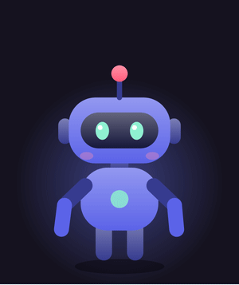
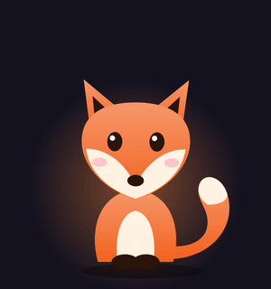
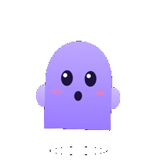
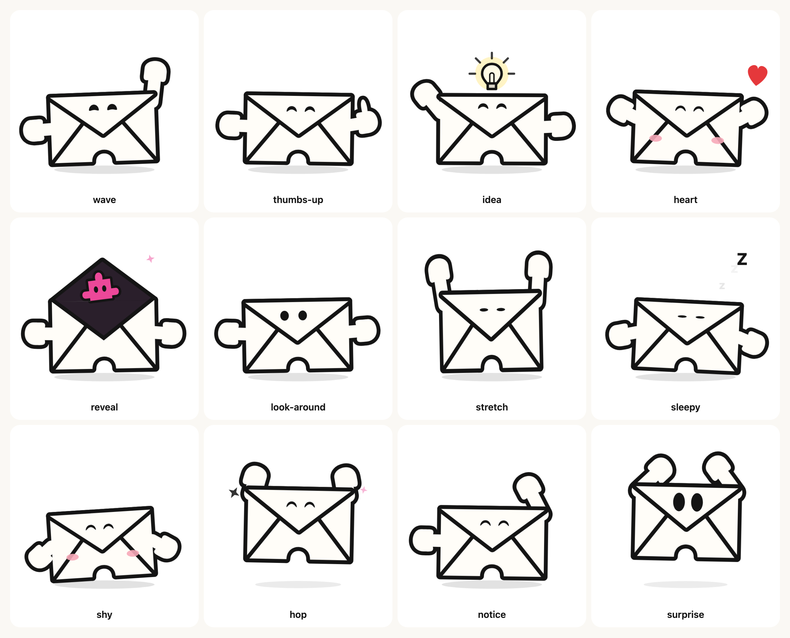
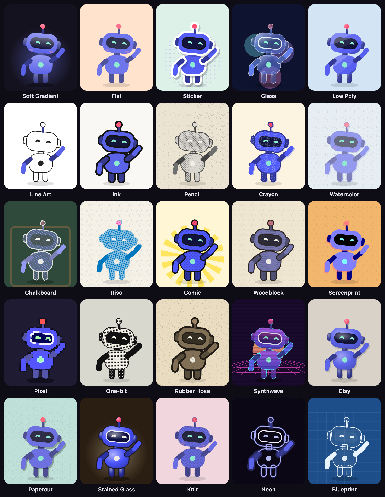
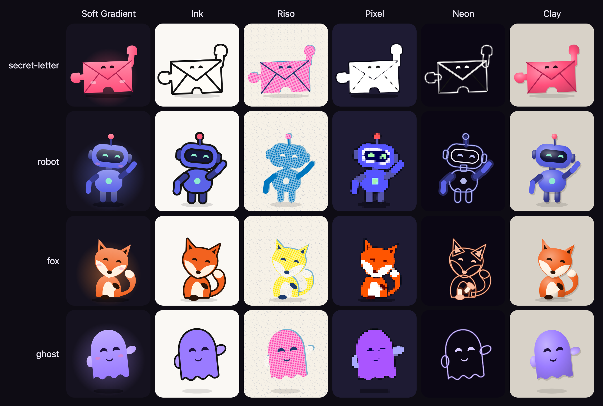

<div align="center">

# mascot-studio

**Original SVG mascots that feel alive** — real rigs, clean lines, 60 fps motion, zero dependencies.

<table>
<tr>
<td align="center"><br><sub><b>Secret Letter</b> · object-limbs · ink</sub></td>
<td align="center"><br><sub><b>Robot</b> · biped · soft gradient</sub></td>
<td align="center"><br><sub><b>Fox</b> · quadruped · soft gradient</sub></td>
<td align="center"><br><sub><b>Ghost</b> · floater · soft gradient</sub></td>
</tr>
</table>

<sub>Every frame is drawn and animated in code. Same mascot, any style: the anatomy says what is drawn, the style how.</sub>

</div>

## What it does

A mascot here is not a video: it is a live SVG that breathes, blinks, looks at your pointer, says hi when you hover it and jumps when you click it. Between those moments it picks what to do next on its own — never the same thing twice in a row.



| | |
|---|---|
| **Idle life that never stops** | breathing, weight shifts, blinks (fast to close, slower to open), glances |
| **Reactions** | hover → it notices you and waves; click → surprise jump |
| **Actions** | wave, thumbs-up, idea, heart, reveal, look-around, stretch, sleepy, shy, hop |
| **Light** | each SVG is a few KB; the whole kit has no runtime dependencies |
| **Polite** | pauses off screen and in hidden tabs; reduced motion holds a still pose |

## One mascot, 25 styles



A style decides how a mascot is drawn — line, fill, texture, palette, eyes, stage and rhythm.
Anatomies never pick colours: they ask the style for a role (`body`, `belly`, `eye`…), so every
mascot works in every style. **No two styles share more than 3 of those 7 axes** (a test checks
it), and a visual check renders every style and fails if two look alike.

**Try them all:** `pnpm dev` and open `/styles.html` — pick a mascot, watch it in every style,
open one to play its actions. `pnpm build:gallery` makes the same page as one HTML file.



| Family | Style | Look |
|---|---|---|
| Clean vector | [Soft Gradient](styles/soft-gradient/STYLE.md) | No outline: every piece has a vertical gradient, a glow of the character's colour behind it, eyes with a shine. |
|  | [Flat](styles/flat/STYLE.md) | Solid colours, no outline, no gradient: shapes and nothing else. |
|  | [Sticker](styles/sticker/STYLE.md) | A thick white border and a hard shadow, like a die-cut sticker on a dotted page. |
|  | [Glass](styles/glass/STYLE.md) | Translucent tinted glass with a bright edge, over colourful blurred blobs. |
|  | [Low Poly](styles/low-poly/STYLE.md) | Faceted shading in hard diagonal bands, like a low-polygon model. |
|  | [Line Art](styles/line-art/STYLE.md) | A single thin line around every piece on white paper; colour only in the eyes. |
| Drawn by hand | [Ink](styles/ink/STYLE.md) | A heavy black line around every shape, flat paper colours, one accent. |
|  | [Pencil](styles/pencil/STYLE.md) | Graphite on paper: hatched shading, a soft boiling line, on twos. |
|  | [Crayon](styles/crayon/STYLE.md) | Waxy crayon that spills past a wobbly dark line, on twos. |
|  | [Watercolor](styles/watercolor/STYLE.md) | Pale washes that bleed past their edges, a faint darker rim, paper grain. |
|  | [Chalkboard](styles/chalkboard/STYLE.md) | Chalk on a green board: dusty hatching, a light boiling line, a wooden frame. |
| Print | [Riso](styles/riso/STYLE.md) | Two-ink risograph: halftone fills in pink and blue, slightly misregistered, grainy paper. |
|  | [Comic](styles/comic/STYLE.md) | Bold ink line, Ben-Day dots and a sunburst behind, like a comic panel. |
|  | [Woodblock](styles/woodblock/STYLE.md) | A woodblock print: muted flat colours with wood grain, a fine dark key line. |
|  | [Screenprint](styles/screenprint/STYLE.md) | Flat posterised colours with an accent plate printed off register. |
| Retro screen | [Pixel](styles/pixel/STYLE.md) | Big pixels, a limited palette and motion that steps at 8 fps. |
|  | [One-bit](styles/one-bit/STYLE.md) | Black and white only, with ordered dither for grey, like an early Mac. |
|  | [Rubber Hose](styles/rubber-hose/STYLE.md) | A 1930s cartoon: sepia, a fat black line, film grain, on twos. |
|  | [Synthwave](styles/synthwave/STYLE.md) | Pink-to-purple gradients, a cyan neon edge, scanlines, a striped sun and a grid. |
| Materials | [Clay](styles/clay/STYLE.md) | Plasticine: round soft highlights, a contact shadow, stop-motion at 8 fps. |
|  | [Papercut](styles/papercut/STYLE.md) | Layers of cut paper casting shadows on each other, stop-motion. |
|  | [Stained Glass](styles/stained-glass/STYLE.md) | Jewel-coloured glass in heavy lead came, glowing from behind. |
|  | [Knit](styles/knit/STYLE.md) | A knitted plush: V-stitch texture in every colour, a soft darker seam. |
| Light and plan | [Neon](styles/neon/STYLE.md) | Glass tubes of light on a dark wall: no fill, a bright core and a glow, a flicker. |
|  | [Blueprint](styles/blueprint/STYLE.md) | White technical lines on blueprint blue over a grid. |

A mascot can tune its palette per style (`palettes` in `mascot.json`, by style id or
`"@no-outline"` for every style without an outline). The style catalogue takes inspiration from
[Lemo-Opuscar](https://github.com/lemomo-ai/lemo-opuscar)'s film styles (see THIRD_PARTY.md).

## How it works

1. **An anatomy** — the skeleton: parts, real pivots, channels, built-in life and actions (`anatomies/`).
2. **A seamless rig** — each layer is drawn twice, outlines first and fills on top, so where parts meet there is no seam (`kit/rig.ts`).
3. **One clock** and the motion engine ported from [rossark-motion-skill](https://github.com/rossark0/rossark-motion-skill): smooth paths through key poses, never stopping dead at each one (`kit/motion.ts`).
4. **Springs for follow-through** — tabs, props and the gaze trail the body a beat later (`kit/spring.ts`).
5. **Shape morphs** — a puzzle tab stretches into an arm or grows a thumb, point by point (`kit/morph.ts`).
6. **A director** that blends actions over the idle life and reacts to you (`kit/director.ts`).

## Make your own

A mascot is a `mascot.json`: an anatomy (the skeleton, with idle life and reactions built in),
a palette, proportions, props and its own actions as keyframes on named channels. No engine code.

```jsonc
{
  "name": "my-mascot", "title": "My Mascot", "anatomy": "object-limbs",
  "palette": { "ink": "#141414", "body": "#FFFDF8", "inside": "#2A1F2B", "accent": "#EC4899", "cheek": "#F7A8B8", "prop": "#E5383B", "glow": "#FFE680" },
  "props": { "heart": [98, -86] },
  "actions": [
    { "name": "love", "duration": 2400, "weight": 2, "tracks": [
      { "ch": "prop.heart", "op": "set", "curve": "linear", "keys": [[0, 0], [2400, 1]] },
      { "ch": "eyes.happy", "keys": [[0, 1], [2400, 1]] }
    ] }
  ]
}
```

Then `pnpm check my-mascot` runs every rule in [CRAFT.md](CRAFT.md): the spec against its
[anatomy](anatomies/object-limbs/ANATOMY.md), and every action frame by frame (in frame, no jumps,
a good rest pose, budget). Green means it ships.

## Try it

```bash
pnpm install
pnpm dev                                   # playground: every mascot, a button per action
pnpm check                                 # every rule, every mascot, every style, every frame
node tools/render.mjs secret-letter \
  --reel wave,idea,reveal --ms 12000       # deterministic MP4 + GIF export
node tools/grid.mjs secret-letter wave:1300,idea:1400   # labelled stills
node tools/matrix.mjs                      # every mascot in every style
pnpm check:styles                          # no two styles may look alike
```

## Mascots and anatomies

| Mascot | Anatomy | Default style | Its own actions |
|---|---|---|---|
| [Secret Letter](mascots/secret-letter/mascot.json) | [object-limbs](anatomies/object-limbs/ANATOMY.md) | ink | thumbs-up, idea, heart, reveal, sleepy, shy |
| [Robot](mascots/robot/mascot.json) | [biped](anatomies/biped/ANATOMY.md) | soft-gradient | scan, dance, think, nap |
| [Fox](mascots/fox/mascot.json) | [quadruped](anatomies/quadruped/ANATOMY.md) | soft-gradient | wag, ear-flick, pounce, curl-up |
| [Ghost](mascots/ghost/mascot.json) | [floater](anatomies/floater/ANATOMY.md) | soft-gradient | loop, boo, vanish, giggle, sleepy |

Every anatomy also brings `wave`, `hop`, `look-around`, `stretch` and the reactions `notice`
(hover) and `surprise` (click).

## Branches and releases

- `main` (default) holds one `release: vX.Y.Z` commit per release, made by the **Release** workflow.
- `dev` holds every commit; pull requests always target `dev`. Details in [BRANCHING.md](BRANCHING.md).

## Contributing

See [CONTRIBUTING.md](CONTRIBUTING.md), the [Code of Conduct](CODE_OF_CONDUCT.md) and the [security policy](SECURITY.md).

## License

MIT. The motion engine is derived from rossark-motion-skill (MIT): see `NOTICE` and [THIRD_PARTY.md](THIRD_PARTY.md).
