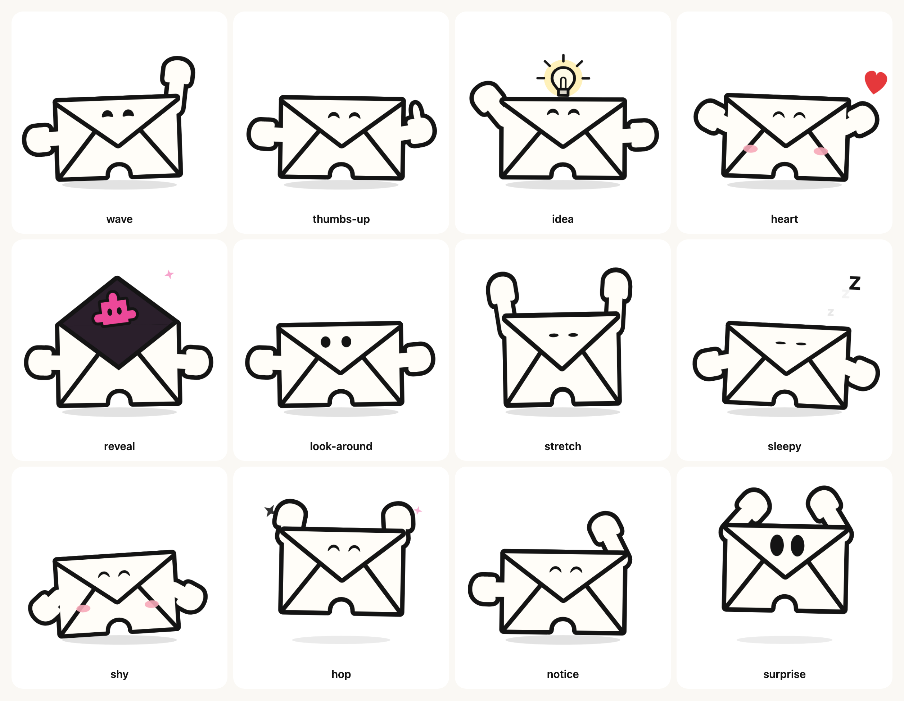

<div align="center">

# mascot-studio

**Original SVG mascots that feel alive** — real rigs, clean lines, 60 fps motion, zero dependencies.


<sub>Cartas Secretas — an envelope that is also a puzzle piece. Every frame is drawn and animated in code.</sub>

</div>

## What it does

A mascot here is not a video: it is a live SVG that breathes, blinks, looks at your pointer, says hi when you hover it and jumps when you click it. Between those moments it picks what to do next on its own — never the same thing twice in a row.



| | |
|---|---|
| **Idle life that never stops** | breathing, weight shifts, blinks (fast to close, slower to open), glances |
| **Reactions** | hover → it notices you and waves; click → surprise jump |
| **Actions** | wave, thumbs-up, idea, heart, reveal, look-around, stretch, sleepy, shy, hop |
| **Light** | each SVG is a few KB; the whole kit has no runtime dependencies |
| **Polite** | pauses off screen and in hidden tabs; reduced motion holds a still pose |

## How it works

1. **One master drawing** with named parts (body, flap, tabs, eyes) and real pivots.
2. **A seamless rig** — each layer is drawn twice, outlines first and fills on top, so where parts meet there is no seam (`kit/rig.ts`).
3. **One clock** and the motion engine ported from [rossark-motion-skill](https://github.com/rossark0/rossark-motion-skill): smooth paths through key poses, never stopping dead at each one (`kit/motion.ts`).
4. **Springs for follow-through** — tabs, props and the gaze trail the body a beat later (`kit/spring.ts`).
5. **Shape morphs** — a puzzle tab stretches into an arm or grows a thumb, point by point (`kit/morph.ts`).
6. **A director** that blends actions over the idle life and reacts to you (`kit/director.ts`).

## Try it

```bash
pnpm install
pnpm dev                                   # playground: every mascot, a button per action
node tools/render.mjs cartas-secretas \
  --reel wave,idea,reveal --ms 12000       # deterministic MP4 + GIF export
node tools/grid.mjs cartas-secretas wave:1300,idea:1400   # labelled stills
```

## Mascots

| Mascot | Look | Status |
|---|---|---|
| [Cartas Secretas](mascots/cartas-secretas/) | heavy black line, white paper, one accent | ✅ |
| Robot (biped, elbows) | modern flat | next |
| Fox (quadruped, tail) | retro cartoon | next |
| Cloud (floater) | hand-drawn | next |

## Branches and releases

- `main` (default) holds one `release: vX.Y.Z` commit per release, made by the **Release** workflow.
- `dev` holds every commit; pull requests always target `dev`. Details in [BRANCHING.md](BRANCHING.md).

## Contributing

See [CONTRIBUTING.md](CONTRIBUTING.md), the [Code of Conduct](CODE_OF_CONDUCT.md) and the [security policy](SECURITY.md).

## License

MIT. The motion engine is derived from rossark-motion-skill (MIT): see `NOTICE` and [THIRD_PARTY.md](THIRD_PARTY.md).
